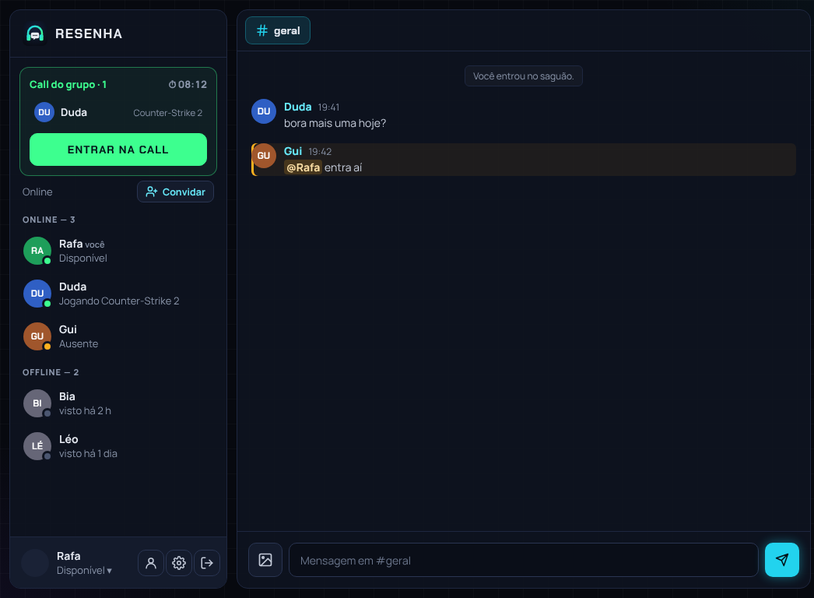
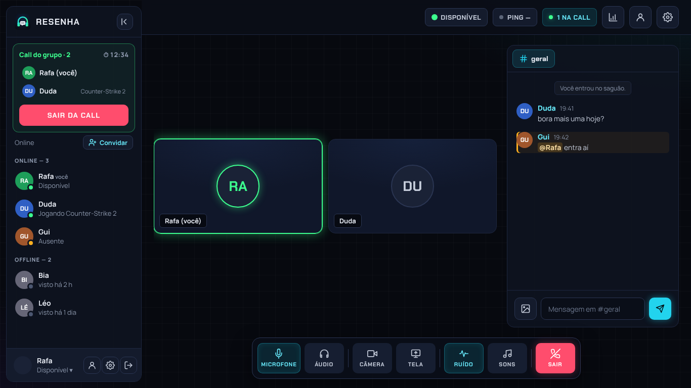

  

  
  
  

<h3 align="center">
  <a href="https://github.com/Alisonfrl/resenha-versoes/releases/latest">⬇️ Baixar para Windows</a>
  &nbsp;·&nbsp;
  <a href="https://alisonfrl.github.io/resenha-versoes/">📱 Abrir no celular / navegador</a>
</h3>

---

## O que é

O **Resenha** é o nosso canto para jogar junto: chamada de voz, câmera, tela compartilhada e chat, num programa só, feito para a nossa turma. Abre, vê quem está online e entra na call com um clique.

  

## O que tem

| | |
|---|---|
| 🎧 **Voz limpa** | Redução de ruído, ativação por voz ou push-to-talk, volume de cada amigo separado. |
| 🖥️ **Tela e câmera** | Compartilhe o jogo em alta qualidade ou ligue a câmera, com fundo desfocado. |
| 💬 **Chat de verdade** | Chat geral e mensagens privadas, @menções, emojis, fotos e arquivos. |
| 🟢 **Quem está on** | Veja quem está online, ausente ou jogando, e quem já está na call. |
| 🔊 **Sons da resenha** | Botões de som para zoar na call e avisos sonoros que você escolhe (ou põe os seus). |
| 🌗 **Do seu jeito** | Tema escuro, claro ou automático. |
| 📱 **No celular também** | Entra na call e no chat pelo navegador, sem instalar nada. |
| 🔄 **Sempre atualizado** | O programa se atualiza sozinho ao abrir. |

  

## Como instalar (Windows)

1. Abra a [**versão mais nova**](https://github.com/Alisonfrl/resenha-versoes/releases/latest) e baixe o arquivo **`Resenha-Setup-x.y.z.exe`**.
2. Abra o arquivo baixado.
3. Se o Windows mostrar um aviso azul, clique em **Mais informações → Executar assim mesmo** (acontece porque o Resenha é um programa nosso, sem assinatura paga).
4. Entre com o convite que recebeu do admin. Pronto: daqui para frente ele se atualiza sozinho.

## No celular

Abra **[alisonfrl.github.io/resenha-versoes](https://alisonfrl.github.io/resenha-versoes/)** no navegador. Dica: no menu do navegador, toque em **Adicionar à tela inicial** para ele ficar com cara de app.

---

Feito pela e para a nossa turma. Bora pra resenha. 🎮

